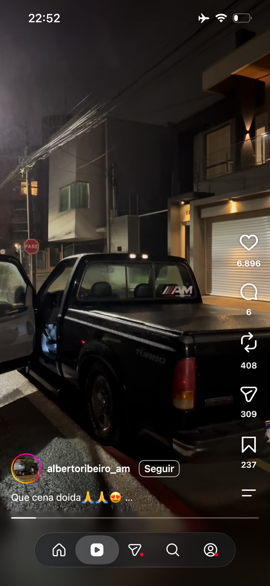
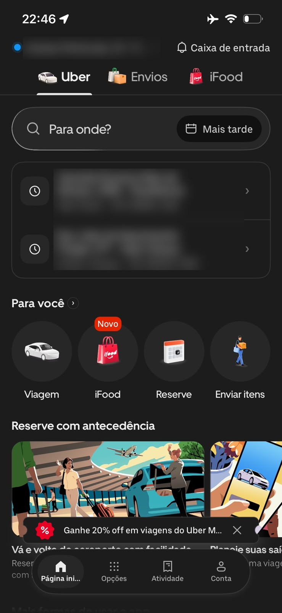
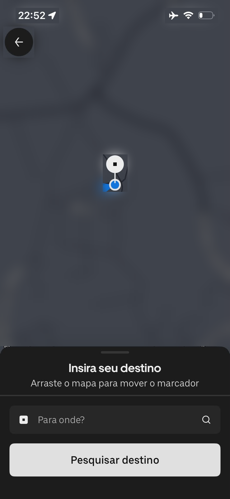
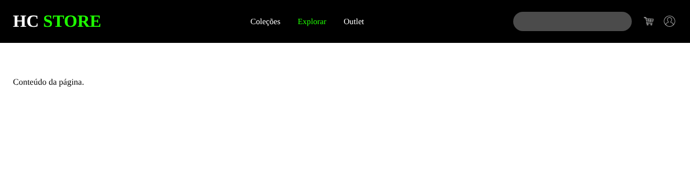
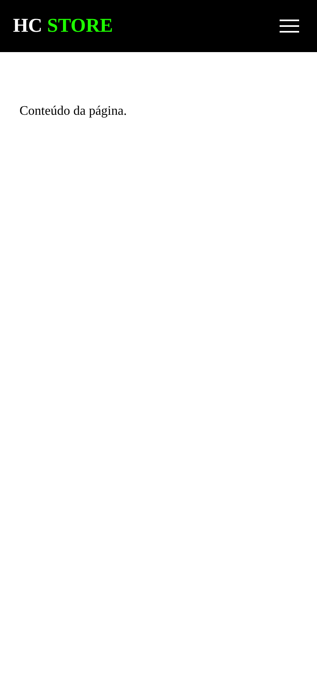
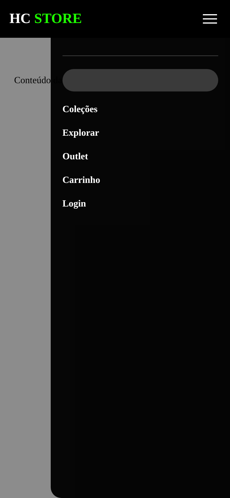
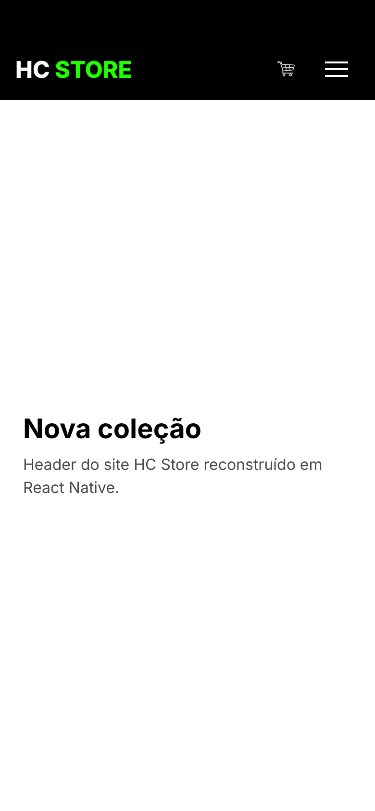
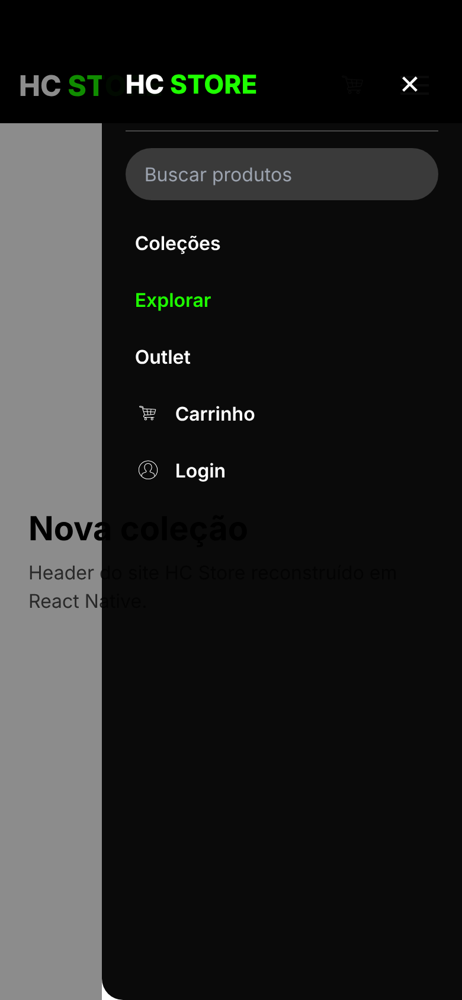

# paradigmas-mobile-henrique

**Paradigmas do desenvolvimento mobile**

Atividade da disciplina sobre as diferenças entre desenvolver para a web e para dispositivos móveis. O repositório reúne a fundamentação teórica, a análise de dois aplicativos de uso diário e a reconstrução de uma Navbar web como componente React Native em um projeto Expo.

## Sumário

1. [Fundamentação](#1-fundamentação)
2. [Pesquisa de campo](#2-pesquisa-de-campo-análise-de-2-aplicativos)
3. [Prática: da web para o React Native](#3-prática-da-web-para-o-react-native)
4. [Conclusão](#4-conclusão)
5. [Referências](#5-referências)
6. [Declaração de uso de IA](#6-declaração-de-uso-de-ia)

## Como executar

```bash
npm install
npx expo start
```

Depois é só escanear o QR Code com o app **Expo Go** (Android ou iOS) ou apertar `w` para abrir no navegador.

---

## 1. Fundamentação

### 1.1 Ciclo de build e distribuição

Na web, o caminho entre salvar o arquivo e o usuário ver a mudança é curto. O código passa por um build (bundler, minificação), vai para um servidor ou CDN e, no próximo carregamento da página, todo mundo já recebe a versão nova. Se aparecer um bug, eu faço outro deploy e em minutos ele some para todos. Quem controla a versão que o usuário roda sou eu.

No mobile essa lógica se inverte. O código precisa ser compilado para cada plataforma (um `.apk`/`.aab` no Android e um `.ipa` no iOS), assinado digitalmente com certificados do desenvolvedor e enviado para a loja. Antes de ficar disponível, o app passa por revisão:

- **App Store (Apple):** a revisão é feita por pessoas e segue as *App Review Guidelines*. Costuma levar de algumas horas a alguns dias e pode recusar o app por motivos como travamentos, uso de permissão sem justificativa, conteúdo ou modelo de pagamento fora das regras.
- **Google Play:** a revisão é mais automatizada e normalmente mais rápida, mas também existe e pode barrar o app. O Google ainda permite liberar a versão aos poucos (*staged rollout*), para uma porcentagem dos usuários.

Mesmo depois de aprovada, a versão nova não chega a todos ao mesmo tempo. Cada pessoa atualiza quando quer (ou quando a atualização automática roda), e muita gente fica meses com uma versão antiga instalada. Isso tem consequências práticas:

- o back-end precisa continuar aceitando requisições de versões antigas do app (APIs versionadas, campos novos opcionais);
- um bug publicado não some com um novo deploy; ele continua no celular de quem não atualizou;
- às vezes é preciso implementar um "forçar atualização", bloqueando versões muito antigas.

No ecossistema Expo existe um meio-termo: as atualizações OTA (*over-the-air*, com o `expo-updates`/EAS Update), que trocam apenas o bundle JavaScript sem passar pela loja. Elas servem para correções na parte JS, mas qualquer mudança em código nativo (uma biblioteca nova com módulo nativo, uma permissão nova) exige um build completo e uma nova revisão.

| | Web | Mobile |
|---|---|---|
| Publicação | Deploy no servidor/CDN | Build assinado + envio para a loja |
| Revisão de terceiros | Não existe | Apple e Google revisam |
| Tempo até o usuário | Minutos | Horas a dias (mais o tempo do usuário atualizar) |
| Versões em uso | Uma só | Várias ao mesmo tempo |
| Rollback | Novo deploy | Nova versão na loja (ou OTA, quando possível) |

### 1.2 Ciclo de vida do aplicativo

Um app mobile não fica simplesmente "aberto" ou "fechado". O sistema operacional controla em que estado ele está, porque precisa economizar bateria e memória. De forma simplificada, os estados são:

- **Ativo (*active* / *foreground*):** o app está na tela e recebendo toques.
- **Inativo (*inactive*, mais visível no iOS):** um estado de transição, por exemplo quando chega uma ligação ou a central de controle é puxada por cima do app.
- **Em segundo plano (*background*):** o usuário foi para outro app ou para a tela inicial. O app ainda está na memória, mas fica praticamente congelado; só pode rodar tarefas curtas ou específicas (tocar música, baixar arquivo, receber localização) se pedir isso ao sistema.
- **Encerrado pelo sistema (*terminated*):** se faltar memória, o sistema mata o processo sem avisar. Quando o usuário volta, o app abre do zero, e ele espera encontrar a tela onde estava.

No React Native dá para acompanhar essas mudanças com a API `AppState`, que informa quando o app passa de `active` para `background` e vice-versa. É o momento de salvar um rascunho, pausar um vídeo ou recarregar dados que podem estar desatualizados.

**Comparando com a web e o desktop:**

- **Aba de navegador:** também tem algo parecido (a Page Visibility API avisa quando a aba fica oculta, e navegadores congelam ou descartam abas inativas), mas o desenvolvedor web costuma ignorar isso, porque fechar a aba é uma ação explícita do usuário e recarregar a página é algo esperado.
- **Programa de desktop:** em geral continua rodando em segundo plano com todos os recursos até o usuário fechar. Memória e bateria raramente forçam o encerramento.
- **App mobile:** o encerramento pode acontecer a qualquer momento e sem aviso, então o app precisa ser pensado para salvar e restaurar estado o tempo todo.

### 1.3 Restrições do dispositivo

- **Bateria:** tudo que mantém o processador, o GPS, a tela ou o rádio de rede ativos gasta bateria. Requisições em excesso, animações pesadas e localização em tempo real precisam de justificativa. Os sistemas limitam tarefas em segundo plano justamente por isso.
- **Memória:** celulares têm menos RAM livre que um computador e o sistema mata apps que exageram. Listas longas precisam ser virtualizadas (`FlatList` em vez de renderizar tudo com `map`), e imagens grandes devem ser redimensionadas.
- **Rede instável ou ausente:** o usuário entra no elevador, no metrô ou está no 3G da estrada. O app precisa tratar *timeout*, mostrar estado de carregamento, guardar dados em cache e, quando fizer sentido, funcionar offline e sincronizar depois. Também é preciso lembrar que o plano de dados é limitado.
- **Tamanho e densidade de tela:** existem telas de 4" a tablets de 13", com densidades diferentes. Por isso o React Native trabalha com *density-independent pixels* (dp/pt): um valor `16` ocupa um tamanho físico parecido em qualquer aparelho, e as imagens precisam de versões `@2x`/`@3x`.
- **Orientação:** o usuário pode girar o celular. O layout precisa se adaptar (ou o app deve travar a orientação, como faz o `"orientation": "portrait"` do `app.json`). O `useWindowDimensions` ajuda a reagir a essa mudança.
- **Notch e safe area:** o entalhe da câmera, a *Dynamic Island*, os cantos arredondados e a barra de gestos inferior ocupam parte da tela. Conteúdo importante precisa ficar dentro da *safe area*, o que se resolve com `react-native-safe-area-context` ou com *paddings* calculados.
- **Permissões:** câmera, microfone, localização, contatos, fotos e notificações dependem de autorização explícita do usuário, que pode negar ou revogar depois nas configurações. A boa prática é pedir no momento em que a funcionalidade é usada, explicando o motivo, e o app precisa continuar funcionando (mesmo que parcialmente) se a resposta for "não". No iOS, o texto que justifica a permissão é obrigatório e é verificado na revisão da loja.

### 1.4 Entrada e interação

- **Toque x mouse e teclado:** o mouse é preciso (um pixel) e tem estados intermediários, como passar por cima (*hover*) e clique direito. O dedo cobre uma área grande, esconde o que está embaixo dele e não tem *hover*. Por isso, tudo o que na web depende de *hover* (menus, *tooltips*) precisa de outra solução no mobile.
- **Área mínima de toque:** a Apple recomenda no mínimo **44 × 44 pt** e o Material Design recomenda **48 × 48 dp** para qualquer elemento tocável. Um ícone pode ser visualmente pequeno, mas a área tocável em volta precisa ter esse tamanho (no React Native, com `padding` ou `hitSlop`).
- **Feedback ao toque:** como não há *hover*, o usuário precisa ver que o toque foi registrado: mudança de opacidade, cor de fundo ao pressionar (`Pressable` com estado `pressed`), vibração leve.
- **Gestos:** deslizar para voltar, puxar para atualizar (*pull to refresh*), deslizar um item para apagar, pinça para zoom, toque longo. Os gestos são rápidos, mas não aparecem na tela, então as ações importantes precisam também de um botão visível.
- **Teclado virtual:** quando um campo recebe foco, o teclado ocupa quase metade da tela e pode esconder o próprio campo ou o botão de enviar. É necessário usar `KeyboardAvoidingView` ou rolar a tela, escolher o tipo de teclado certo (`keyboardType="email-address"`, `numeric`) e permitir fechar o teclado tocando fora.

### 1.5 UX mobile

- **Contexto de uso:** no computador, a pessoa geralmente está sentada, com atenção e tempo. No celular, ela está em pé no ônibus, andando, com uma mão ocupada, no sol forte ou com pressa. As sessões são curtas e interrompidas, então a tarefa principal precisa ser resolvida em poucos toques e o app precisa lembrar onde o usuário parou.
- **Zona do polegar:** como muita gente usa o celular com uma mão só, a parte de baixo e o centro da tela são fáceis de alcançar com o polegar, enquanto os cantos superiores são difíceis (principalmente em telas grandes). Por isso as ações principais migraram para baixo: barras de abas inferiores, botão flutuante no canto inferior, barra de busca embaixo em alguns navegadores.

```
┌───────────────┐
│ ✗ difícil   ✗ │   ← cantos de cima: ações raras (configurações, perfil)
│               │
│   ~ alcance   │
│     médio     │
│               │
│  ✓ fácil  ✓   │   ← parte de baixo: navegação e ação principal
└───────────────┘
   (uso com a mão direita)
```

- **Padrões de navegação mobile:**
  - **Tab bar (barra de abas inferior):** de 3 a 5 seções principais sempre visíveis; é o padrão mais comum hoje.
  - **Stack (pilha):** cada tela nova é empilhada sobre a anterior, com botão e gesto de voltar.
  - **Drawer (menu lateral / hambúrguer):** esconde muitas opções, mas reduz a descoberta, e por isso costuma ficar para itens secundários.
  - **Modais e *bottom sheets*:** para tarefas curtas sem perder o contexto da tela de trás.

---

## 2. Pesquisa de campo: análise de 2 aplicativos

Escolhi dois apps que uso todos os dias no meu iPhone e que também têm versão web: **Instagram** e **Uber**. Os prints estão em [`docs/apps`](docs/apps). Nos prints do Uber, borrei a localização atual, os destinos recentes e os nomes das ruas do mapa, porque são dados pessoais.

### 2.1 Instagram

| Feed (Início) | Reels |
|---|---|
|  |  |

**Zona do polegar e navegação.** Toda a navegação principal fica numa barra de abas flutuante na parte de baixo da tela: Início, Reels, Direct (mensagens), Busca e Perfil. Na versão atual, o Direct e os Reels vieram para a barra de baixo; antes, o Direct ficava no canto superior direito, que é justamente a região mais difícil de alcançar com uma mão. As ações de cada post (curtir, comentar, repostar, enviar e salvar) ficam logo abaixo da imagem, numa linha horizontal, e o *scroll* infinito do feed é feito com o polegar, de baixo para cima. Nos Reels, a disposição muda: o vídeo ocupa a tela toda e as ações (curtir, comentar, repostar, enviar e salvar) ficam empilhadas na **lateral direita, na metade de baixo**, exatamente onde o polegar direito descansa quando seguro o celular com uma mão. O nome do perfil, o botão "Seguir" e a legenda ficam embaixo à esquerda, e a barra de progresso do vídeo fica logo acima da barra de abas.

**Gestos.** Grande parte da interação é por gestos: deslizar para o lado no carrossel (os pontinhos abaixo da imagem indicam que o post tem mais fotos e em qual delas eu estou), tocar duas vezes na foto para curtir, segurar para ver uma prévia e puxar o feed para baixo para atualizar. Nos Reels, deslizar para cima passa para o próximo vídeo e segurar o dedo na tela pausa. É uma interface feita para ser usada sem olhar para botões. Como os gestos não aparecem na tela, o app mantém os mesmos comandos também como botões (o coração faz o mesmo que o toque duplo).

**Tela, notch e safe area.** O app usa layout *edge-to-edge*: a foto do post passa por baixo da barra de status (relógio, Wi-Fi e bateria aparecem por cima da imagem). A barra de abas também fica por cima do conteúdo, com fundo translúcido, e o vídeo do próximo post aparece por trás dela. Ou seja, o app desenha a tela inteira, mas mantém os elementos tocáveis dentro da *safe area*: a barra de abas fica acima da barra de gestos do iPhone, e a imagem embaixo do relógio é só decoração.

**Rede instável ou ausente.** Sem internet, o app abre mostrando os posts que já estavam em cache e um aviso de que não foi possível atualizar o feed. Curtidas e comentários feitos offline ficam pendentes e são enviados depois. As imagens são carregadas em resolução menor quando a conexão está lenta, e há uma opção de "Usar menos dados móveis" nas configurações.

**Permissões.** A câmera, o microfone e a galeria só são pedidos quando eu toco para criar um story ou post, e as notificações são pedidas com uma tela própria do app antes da janela do sistema.

**Comparação com o Instagram na web.** No navegador do computador, a navegação vira uma barra lateral fixa à esquerda, e o feed fica numa coluna central estreita, com muito espaço vazio dos lados. Na grade do perfil, passar o mouse sobre uma foto mostra o número de curtidas e comentários (*hover*), algo que não existe no celular. Os carrosséis usam setas clicáveis no lugar do deslizar. Criar posts e stories é bem mais limitado na web, porque a experiência foi pensada para a câmera do celular. Para mim, o app é a experiência principal e a web serve mais para responder mensagens no computador.

### 2.2 Uber

| Página inicial | Escolha do destino no mapa |
|---|---|
|  |  |

**Permissões e localização.** O ícone de seta ao lado do relógio, na barra de status, indica que o app está usando a localização naquele momento. O Uber depende disso: a localização atual aparece no topo da tela (o ponto azul) e é usada como ponto de partida. Ele pede a permissão de localização logo no primeiro uso, explicando que precisa dela para achar o motorista, e, se eu negar, o app continua funcionando, mas obriga a digitar o endereço de partida. A permissão de notificações é justificada pelos avisos de "motorista chegando".

**Zona do polegar e navegação.** Aqui há uma mistura. A barra de abas principal (Página inicial, Opções, Atividade, Conta) fica embaixo, flutuante e fácil de alcançar. Mas a ação mais importante, o campo "Para onde?", fica no terço superior da tela, assim como as abas Uber/Envios/iFood. Para compensar, os destinos recentes aparecem logo abaixo como itens grandes e tocáveis, então o caso mais comum (voltar para um lugar conhecido) se resolve com um toque, sem digitar. Os atalhos "Para você" são círculos grandes com ícone e texto, bem acima do mínimo de 44 pt de área de toque.

Na tela de escolher o destino pelo mapa, essa lógica fica mais clara: tudo o que é para tocar foi para baixo, num *bottom sheet* com o título "Insira seu destino", o campo "Para onde?" e um botão "Pesquisar destino" que ocupa a largura inteira. Em cima ficam só o mapa e um botão circular de voltar no canto superior esquerdo, que é uma ação rara. O *bottom sheet* tem uma alça (o tracinho no topo) indicando que pode ser arrastado.

**Gestos.** O destino pode ser escolhido arrastando o mapa: o marcador fica fixo no centro da tela e o mapa se move por baixo dele, como diz a instrução "Arraste o mapa para mover o marcador". É uma solução pensada para o dedo, porque arrastar um marcador pequeno com precisão seria difícil, já que o próprio dedo esconderia o ponto. Pinça para zoom e o ponto azul com o cone de direção (que vem da bússola do celular) completam a interação.

**Contexto de uso.** O app é claramente pensado para quem está com pressa, em pé na rua: a primeira coisa na tela é a pergunta "Para onde?", e o restante é secundário. O aviso de promoção ("Ganhe 20% off...") aparece como um *banner* que pode ser fechado no X, colado acima da barra de abas, sem bloquear a tela inteira.

**Rede instável ou ausente.** Diferente do Instagram, o Uber não tem como funcionar offline, porque pedir uma corrida exige o servidor. Sem conexão, ele mostra um aviso de que não há internet e bloqueia o pedido. Durante a corrida, se o sinal cai, o mapa congela na última posição conhecida e a viagem continua normalmente; a cobrança é feita no servidor.

**Ciclo de vida.** Depois de pedir uma corrida, posso sair do app ou bloquear a tela: o andamento aparece na tela de bloqueio como Atividade ao Vivo (iOS) e em notificações. Se o sistema encerrar o app em segundo plano, ao abrir de novo ele volta direto para a corrida em andamento, porque o estado fica no servidor e não só no aparelho.

**Comparação com o Uber na web.** Pelo navegador (m.uber.com) também dá para pedir corridas. No computador, a tela fica dividida, com o formulário de partida e destino à esquerda e um mapa grande à direita. A localização depende da permissão do navegador e costuma ser menos precisa que o GPS do celular, então muitas vezes é preciso digitar o endereço de partida. Não há Atividade ao Vivo nem notificações tão integradas, e a aba precisa ficar aberta para acompanhar o motorista. A versão web resolve o básico, mas o app é muito mais prático para o uso real, que é no meio da rua.

---

## 3. Prática: da web para o React Native

Escolhi reconstruir o **header do HC Store**, a loja virtual que desenvolvi em Angular ([`hc-store-web`](https://github.com/henriqueramoss-dev/hc-store-web), em `src/app/layout/header`). Uma cópia estática do HTML e do CSS originais está em [`docs/comparacao/web`](docs/comparacao/web), e a versão mobile está em [`src/components/Navbar.js`](src/components/Navbar.js).

### O componente

- Recebe o conteúdo por props: `brandHighlight` e `brandName` (o "**HC** STORE"), `links` (lista de `{ id, label }`) e os callbacks opcionais `onLinkPress`, `onCartPress`, `onLoginPress` e `onSearch`.
- É estilizado só com `StyleSheet.create` e Flexbox, mantendo as cores do site (fundo preto, verde `#1eff00`, busca cinza com borda arredondada).
- Usa três `useState`:
  - `isMenuOpen` abre e fecha o menu lateral, assim como o `menuMobileOpen`/`toggleMenu()` do componente Angular;
  - `activeLinkId` destaca em verde a seção escolhida;
  - `searchText` controla o campo de busca.
- O menu lateral é um `Modal` com fundo escurecido. Tocar fora, no ✕ ou no botão voltar do Android fecha o menu.
- Todas as áreas tocáveis têm no mínimo 48 × 48.

```jsx
<Navbar
  brandHighlight="HC"
  brandName="STORE"
  links={[
    { id: 'colecoes', label: 'Coleções' },
    { id: 'explorar', label: 'Explorar' },
    { id: 'outlet', label: 'Outlet' },
  ]}
/>
```

O histórico de commits mostra a evolução: primeiro fiz uma Navbar genérica para aprender a estrutura (`feat: reconstroi navbar...` e `feat: adiciona abertura do menu...`) e depois adaptei o componente para o header real do HC Store (`refactor: adapta navbar ao header do hc-store`).

### Web x app

| Web no desktop (*hover* em "Explorar") |
|---|
|  |

| Web em largura de celular | Web com menu aberto | App (menu fechado) | App (menu aberto, "Explorar" ativo) |
|---|---|---|---|
|  |  |  |  |

> Os prints do app foram gerados com o mesmo código rodando via `react-native-web`, numa janela do tamanho de um iPhone (390 × 844). No Expo Go, o layout é o mesmo, com a barra de status real do aparelho por cima do `paddingTop`.

### Diferenças encontradas na reconstrução

1. **Não existe `header`, `nav`, `div`, `a`, `h1`, `button` nem `input`.** Toda a estrutura virou `View`, os textos viraram `Text`, os links e botões viraram `Pressable` e o `input` virou `TextInput`. A semântica que vinha das tags passou para props como `accessibilityRole="button"` e `accessibilityLabel="Abrir menu"`, que fazem o papel do `aria-label` do botão hambúrguer original.

2. **Todo texto precisa estar dentro de `Text`.** No HTML, o "HC" fica num `<span class="hg">` dentro do `<h1>`. No React Native, a mesma ideia funciona com um `Text` dentro de outro `Text`. Esse é o único caso em que existe herança de estilo: o "STORE" herda o verde do `Text` de fora, e o "HC" sobrescreve com branco.

3. **`flexDirection` padrão é `column`.** O `header` do site tinha `display: flex` e já ficava em linha. No React Native, toda `View` já é flex, mas empilha os filhos na vertical, então precisei de `flexDirection: 'row'` na barra. Já o menu lateral, que no CSS precisava de `flex-direction: column`, ficou em coluna sem declarar nada.

4. **Estilos não têm cascata nem seletores.** O CSS do site usa seletores como `.navbar-conteiner a`, `.menu-mobile a` e `header h1`, que estilizam vários elementos de uma vez. No React Native não há seletor nem herança do pai para o filho: cada `Text` do menu recebe `styles.menuText` explicitamente, e o estado ativo é feito combinando estilos num array (`[styles.menuText, isActive && styles.menuTextActive]`).

5. **Unidades sem `px` e sem `rem`.** `font-size: 1.5rem` e `min-height: 64px` (da versão mobile do CSS) viraram números puros (`fontSize: 24`, `minHeight: 64`), em pixels independentes de densidade. Porcentagem ainda funciona em alguns casos (`width: '78%'` no menu), mas `vh` não existe: o `height: 100vh` do menu virou um `Modal` que já ocupa a tela toda.

6. **Não existe `:hover` nem `transition`.** No site, os links ficam verdes quando o mouse passa por cima (`a:hover { color: #1eff00; transition: 0.3s }`). No celular não há cursor, então o feedback passou a ser o toque: `Pressable` com `style={({ pressed }) => ...}` escurece o fundo enquanto o dedo está pressionando. O verde ficou para indicar o link **ativo**, controlado por estado. A animação de deslizar do menu (`transition: right 0.3s`) foi substituída pelo `animationType="fade"` do `Modal`.

7. **Sem *media query*: a versão mobile é a padrão.** O site esconde os links, a busca e os ícones abaixo de 768px (`display: none`) e só então mostra o hambúrguer. No app não existe essa troca: o hambúrguer é sempre o comportamento normal. Mantive o ícone do carrinho visível na barra porque, numa loja, ele é uma das ações mais usadas.

8. **`position: fixed` e `z-index` viraram `Modal`.** O menu do site é uma `div` com `position: fixed`, `right: -100%` e `z-index: 999`, que desliza para `right: 0` quando ganha a classe `.active`, com o overlay por trás. No React Native, o `Modal` desenha por cima de tudo, sem precisar calcular `z-index`. Montei o overlay e o painel lado a lado com Flexbox (`flexDirection: 'row'`, overlay com `flex: 1`). Isso evita um problema que encontrei no CSS original: como o `header` tem `z-index: 1000`, ele fica por cima do menu (999), e o "HC STORE" do topo do menu mobile some atrás dele (dá para ver no print da versão web com o menu aberto).

9. **Mostrar e esconder é renderização condicional, não classe.** No Angular, o menu já existe na página e `[class.active]="menuMobileOpen"` só troca a classe. No React Native, `visible={isMenuOpen}` faz o `Modal` aparecer ou não. O `(click)="toggleMenu()"` do Angular virou `onPress={() => setIsMenuOpen(true)}`, e o `menuMobileOpen = !menuMobileOpen` virou a função `setIsMenuOpen` do `useState`.

10. **Links não navegam sozinhos.** O site usa `routerLink="/colecoes"`, e o roteador do Angular já troca a página. No app, o `Pressable` só chama uma função; a navegação real precisaria do Expo Router ou do React Navigation. Por isso o componente expõe `onLinkPress` e deixa quem usa decidir o que fazer.

11. **Imagens SVG não funcionam direto.** O site usa ``. O componente `Image` do React Native não renderiza SVG sem uma biblioteca extra (`react-native-svg`). Como os SVGs do projeto tinham um PNG embutido, extraí as imagens para `assets/icons/*.png` e carreguei com `require(...)`, que também é diferente do caminho em string usado na web.

12. **O campo de busca é controlado e abre o teclado virtual.** O `<input>` do site não tinha estado. No app, o `TextInput` usa `value` e `onChangeText` ligados ao `useState`, e precisei pensar no teclado: `returnKeyType="search"` troca o botão do teclado por "Buscar", e `placeholderTextColor` precisa ser definido à parte, porque o `placeholder` não herda cor de lugar nenhum.

13. **Barra de status e notch.** No navegador, o header começa abaixo da barra de endereço. No app, ele começa no topo físico da tela, atrás do relógio e da câmera. Somei um `paddingTop` calculado (`StatusBar.currentHeight` no Android) e usei `<StatusBar style="light" />` para os ícones do sistema ficarem brancos sobre o fundo preto. O painel do menu, por abrir num `Modal`, precisa do mesmo cuidado.

14. **Fonte padrão diferente.** O CSS do site não define `font-family`, então o navegador usa a fonte serifada padrão (Times), como se vê nos prints da web. No React Native, o padrão é a fonte do sistema (San Francisco no iOS, Roboto no Android), por isso o app fica com uma aparência mais "nativa" mesmo sem nenhuma configuração.

---

## 4. Conclusão

Depois da pesquisa e da prática, percebi que preciso parar de pensar no mobile como "a web numa tela menor". Na web eu parto do desktop, conto com mouse, rede estável, deploy instantâneo e uma página que só existe enquanto a aba está aberta. No mobile, cada uma dessas premissas cai: o usuário usa o app com uma mão, com pressa e talvez sem internet, o sistema pode encerrar o app a qualquer momento, cada recurso do aparelho depende de permissão e cada versão publicada fica no celular das pessoas por muito tempo, depois de passar pela revisão das lojas. Na prática, isso muda minha ordem de decisões: primeiro penso no contexto de uso e na zona do polegar, depois nos estados de erro, carregamento e falta de rede, e só então no visual. No código, troquei a mentalidade de "documento estilizado por cascata" pela de "componentes com estilo explícito e estado", em que cada texto, cada área tocável e cada pedaço da tela (inclusive o notch) é responsabilidade minha.

---

## Referências

APPLE. **Human Interface Guidelines**. Disponível em: <https://developer.apple.com/design/human-interface-guidelines>. Acesso em: 19 out. 2026.

APPLE. **App Review Guidelines**. Disponível em: <https://developer.apple.com/app-store/review/guidelines>. Acesso em: 19 out. 2026.

ESCUDELARIO, B.; PINHO, D. **React Native**: desenvolvimento de aplicativos mobile com React. São Paulo: Casa do Código, 2021.

EXPO. **Expo Documentation**. Disponível em: <https://docs.expo.dev>. Acesso em: 19 out. 2026.

GOOGLE. **Material Design 3**. Disponível em: <https://m3.material.io>. Acesso em: 19 out. 2026.

HOOBER, S. How Do Users Really Hold Mobile Devices? **UXmatters**, 18 fev. 2013. Disponível em: <https://www.uxmatters.com/mt/archives/2013/02/how-do-users-really-hold-mobile-devices.php>. Acesso em: 19 out. 2026.

REACT NATIVE. **Documentação oficial**. Disponível em: <https://reactnative.dev/docs/getting-started>. Acesso em: 19 out. 2026.

---

## Declaração de uso de IA

ANTHROPIC. Claude Code (modelo Claude Opus 5.5). Ferramenta de inteligência artificial generativa.
Data de uso: 17 out. 2026.
Finalidade: criação do projeto Expo e da estrutura de pastas; redação inicial das seções de fundamentação, análise dos aplicativos (a partir dos meus prints do Instagram e do Uber), lista de diferenças e conclusão, revisadas por mim.
Arquivos impactados: `README.md`, `docs/apps/LEIA-ME.md`.

ANTHROPIC. Claude Code (modelo Claude Opus 5.5). Ferramenta de inteligência artificial generativa.
Data de uso: 17 out. 2026.
Finalidade: conversão dos prints para PNG e desfoque dos endereços e do mapa nos prints do Uber.
Arquivos impactados: `docs/apps/*.png`.

ANTHROPIC. Claude Code (modelo Claude Opus 5.5). Ferramenta de inteligência artificial generativa.
Data de uso: 17 out. 2026.
Finalidade: implementação da primeira versão do componente Navbar (genérica) com props, `StyleSheet` e `useState`.
Arquivos impactados: `src/components/Navbar.js`, `App.js`.

ANTHROPIC. Claude Code (modelo Claude Opus 5.5). Ferramenta de inteligência artificial generativa.
Data de uso: 19 out. 2026.
Finalidade: montagem da versão estática do header do meu projeto HC Store (Angular), adaptação do componente Navbar a esse header (menu lateral com `Modal`, busca com `TextInput`, ícones extraídos dos SVGs originais) e redação da comparação entre o código Angular e o React Native.
Arquivos impactados: `src/components/Navbar.js`, `App.js`, `assets/icons/*.png`, `docs/comparacao/web/*`, `README.md`.
